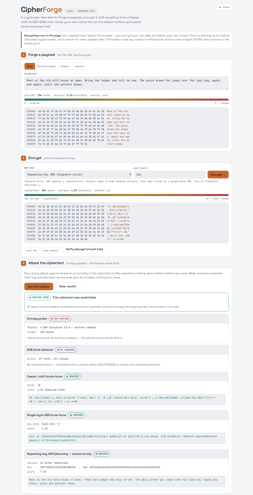

# Cipher Forge

A crypto pen-test bench that fits in one HTML file and runs entirely in your browser. You forge a payload (typed
text, random bytes, a repeating pattern or a file you pick), encrypt it with a scheme of your choice, and then throw
your own ciphertext at a toolbox of classical attacks that assumes nothing about which scheme you used. The toy
schemes surrender their key and plaintext in milliseconds; against AES the toolbox finds no structure to work with.
That contrast is the whole point: it is a learning rig for seeing *why* weak crypto breaks, not a cracker for other
people's files. Read its verdicts as heuristics: the attack cards score candidates by how English-like the output
looks, so on a short or mostly-printable payload they report a false CRACKED on gibberish (the Caesar and single-byte
XOR cards do it in the screenshot below), and the "toolbox wins / held" summary is only a roll-up of those scores, not
a proof either way. See [Known limits](#known-limits).

Nothing leaves the page. There is no server, no analytics and no build step; the only network request is one
Google Fonts stylesheet (and the font files it pulls from fonts.gstatic.com), and the page works without them. The encryption schemes are a Caesar shift, single-byte
XOR, repeating-key XOR (Vigenere-style), RC4, a deliberately weak 8-byte toy block cipher in ECB mode, Base64 (not
encryption, included so you can watch it read straight back) and AES-CTR, AES-CBC and AES-GCM through the browser's
`crypto.subtle` with a SHA-256-derived key. The attacks are single-byte XOR brute force with English scoring, a
repeating-key XOR break (Hamming-distance keysize detection, then per-column brute force: CryptoPals set 1 challenge
6), Caesar brute force, frequency analysis, ECB repeated-block detection and Shannon entropy.

## Architecture

```
index.html          the whole app: styles, markup and the script in one file
  core block        the ciphers and the attacks as pure functions on Uint8Array (no DOM; what tests/check.js loads)
  state / ui        payload buffer, ciphertext buffer, hex dumps, toasts, theme
  stage 1..3        forge a payload -> encrypt it -> run the toolbox
tests/check.js      node: syntax-checks every inline <script> block and asserts the core's round trips and attacks
docs/screenshots/   what it looks like
```

## Quickstart

You need nothing but a browser to use it, and [Node.js](https://nodejs.org/) 18 or newer to run the test.

```sh
git clone https://github.com/printedwicked/cipher-forge
cd cipher-forge
node tests/check.js            # all passed
```

Then open `index.html` in a browser. Double-clicking the file works (`file://`); to serve it instead:

```sh
python -m http.server 8080     # then open http://127.0.0.1:8080/
```

On Linux and macOS the interpreter is usually `python3`; `python3 -m http.server 8080` does the same.

1. **Forge a payload.** Type text, generate random bytes or a pattern, or upload a file. The hex dump shows what
   will be encrypted.
2. **Encrypt it.** Pick a scheme and a key (a shift, a key byte, a key string or an AES passphrase). The ciphertext
   buffer fills; you can copy it as hex or Base64, or decrypt it back to prove the round trip.
3. **Run the toolbox.** Every attack runs blind against whatever is in the ciphertext buffer. Each result card says
   CRACKED or no fit, with the recovered key and plaintext when there is one, and the summary says whether the
   toolbox won or the scheme held.

## Configuration

There is none. The theme button toggles light and dark and remembers the choice in `localStorage` (`cf-theme`); with
no choice stored the page follows the OS preference.

## Screenshots



The page after encrypting the default 156-byte text with repeating-key XOR (key `ICE`) and running the toolbox.
The summary says the toolbox wins, which is right, but look at the cards: the payload is too short for the
Hamming-distance keysize search, which over-estimates the keysize as 24 (a multiple of the real 3) and recovers a
24-byte near-repeat of `ICE` with wrong columns, so the plaintext comes back readable but garbled. The Caesar and
single-byte XOR cards show the false CRACKED on gibberish described above. Paste a few paragraphs instead of the
default text and the same attack finds keysize 3, the exact key and the clean plaintext.

## Known limits

- **Short inputs.** The repeating-key XOR break needs enough bytes to compare blocks per candidate keysize; below a
  few hundred bytes it tends to pick a multiple of the real keysize and recover a noisy key. Pad the payload, do not
  trust the keysize line on a one-liner.
- **False CRACKED.** Every brute-force card reports its best-scoring candidate as CRACKED whenever the English score
  clears a fixed threshold (2.2 per byte); a ciphertext made of mostly printable bytes, as XOR of text with a short
  printable key is, clears it by chance, so the Caesar and single-byte XOR cards claim a crack on such input. Read the
  recovered plaintext, not the badge.
- **The summary is a heuristic.** "Toolbox wins" means at least one card scored above its threshold or the ECB detector
  saw a repeat; "held" means none did. Neither is a proof: a strong scheme can be flagged on a short random payload
  and a weak one can slip through on an unusual plaintext (non-English text, binary files).
- **English only.** The scoring tables are English letter frequencies; other languages and binary payloads score as
  noise, which blinds the XOR and Caesar breaks and inflates the entropy probe's "looks random" reading.
- **The ECB detector** only counts repeated 8-byte blocks (the toy cipher's size); a non-repeating plaintext under ECB
  is reported as "no repeats", which is not a sign of strength.
- **AES is not attacked**, only measured: the entropy probe and the ECB detector run on it, and the brute-force cards
  produce the false positives above. A "cracked" badge on an AES ciphertext is noise, never a break.

## Licence

Licensed under the GNU AGPL-3.0 (see [LICENSE](LICENSE)). Copyright (c) 2026 Printed Wicked.
